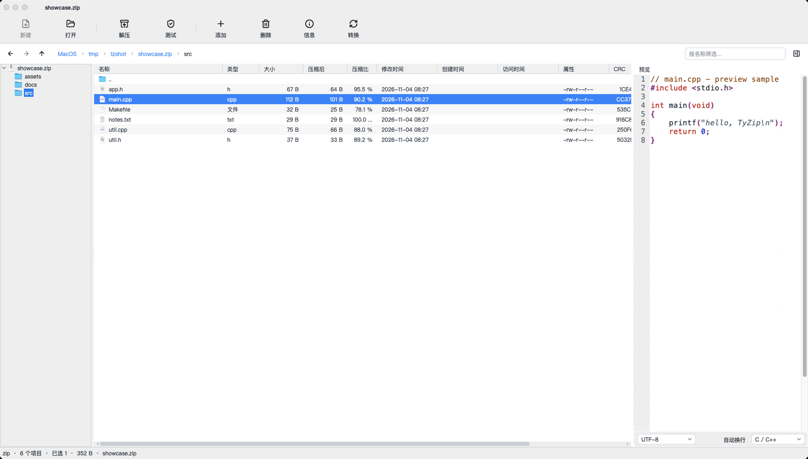
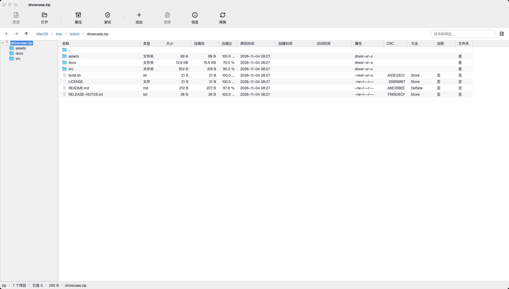
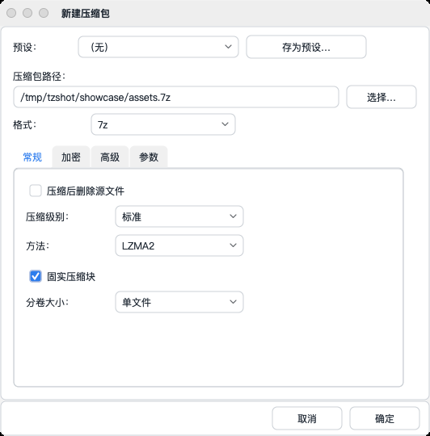
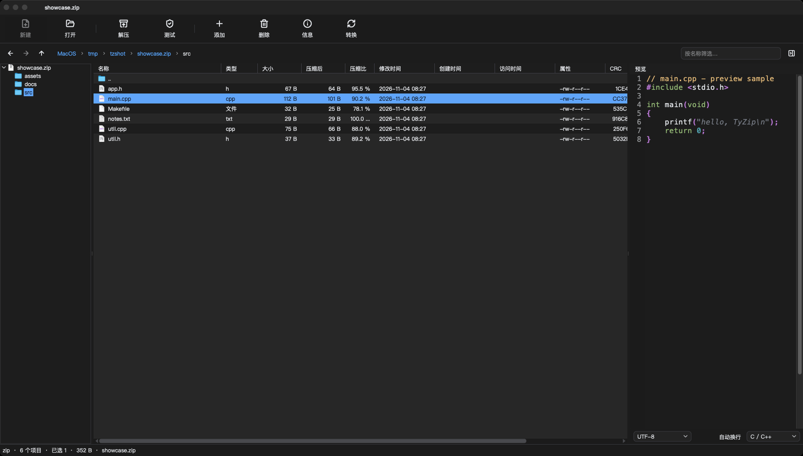

<p align="center">
  
</p>

<h1 align="center">TyZip</h1>

<p align="center">像 Finder 一样浏览压缩包，不偷偷解压。</p>

<p align="center">macOS 归档管理器 · 浏览 / 创建 / 修改 / 解压 / 预览 / 搜索，都在一个窗口里</p>

<p align="center">
  
  
  
</p>

## 这是什么

TyZip 是 macOS 上的归档管理器。打开压缩包后，包内目录像普通文件夹一样逐级浏览，
每个条目显示 **13 列详情**（名称、类型、大小、压缩后大小、压缩比、修改/创建/访问时间、属性、CRC、压缩方法、加密、文件夹标记），
双击内层压缩包还能继续下钻——**不会像「归档实用工具」那样一打开就自动解压**。

浏览、创建、添加/删除条目、解压、测试、转换、预览、搜索、批量处理都在同一个窗口完成。
压缩引擎是官方 **7-Zip 26.03 动态库**（不调用 `7z` 命令行），界面使用 Lazarus / Free Pascal + TyControls。

## 下载与安装

源码公开在 [GitHub](https://github.com/ACTom/TyZip)。目前还没有 GitHub Releases 页面，分发包可自行按[构建文档](docs/BUILDING.md)构建，或使用群内分享的 zip（命名如下）：

| 架构 | 文件名 |
| --- | --- |
| Intel（x86_64） | `TyZip-<version>-x86_64.zip` |
| Apple Silicon（arm64） | `TyZip-<version>-arm64.zip` |

版本号见 [`packaging/version.txt`](packaging/version.txt) 或 [`CHANGELOG.md`](CHANGELOG.md)，zip 约 8 MB。

**安装**

1. 解压 zip，把 `TyZip.app` 拖进 `/Applications`。
2. 第一次打开：在 Finder 里**右键 → 打开**，再点「打开」确认。
   应用只做 ad-hoc 签名、没有公证，Gatekeeper 会先拦一次，这是预期行为。
3. 如果仍被拦截，先去掉隔离属性再打开：

   ```bash
   xattr -dr com.apple.quarantine /Applications/TyZip.app
   ```

把 `TyZip.app` 放进 `/Applications` 并至少启动一次后，Finder 右键 →「服务」里的 TyZip 动作才会出现。
更多问题见 [常见问题](docs/FAQ.md)。

**系统要求**：macOS 11.0 或更新；Intel 与 Apple Silicon 均支持。

## 截图



| 13 列详情，可排序/过滤 | 新建压缩包：格式、级别、加密、分卷 | 包内搜索：名称/内容、通配符/正则 |
| :---: | :---: | :---: |
|  |  |  |

| 深色主题 |
| :---: |
|  |

## 功能亮点

- **浏览**：文件管理器视图与压缩包视图共用一套习惯——面包屑（可双击变地址栏）、前进/后退/上级、隐藏文件、名称过滤、排序、首行固定 `..`；侧边栏文件树按需展开，不扫描网络卷。
- **包内浏览**：包内目录树 + 13 列详情；即使压缩包不记录目录条目（ISO、`zip -D`、部分 tar），也会从条目路径推导完整目录树；文件夹行显示其下所有条目的合计大小。
- **内层压缩包**：双击继续下钻，临时解出的副本只读，离开时清理；`.tar.gz`/`.tar.bz2`/`.tar.xz` 等双层格式先解开外层、内层 tar 只读浏览。
- **拖拽解出**：把归档列表里的文件/文件夹拖到桌面或 Finder 文件夹即可解压；文件在落下时后台解出，文件夹先暂存后拖出。
- **预览**：文本预览带行号、编码自动检测与手动切换、自动换行、约 30 种语言语法高亮（Markdown、C/C++、Python、Rust、Go、JSON、YAML、Shell 等）；图片按比例缩放、拖动、1:1/Fit。文本上限 2 MB、图片上限 32 MB，超出部分截断并提示。
- **创建与修改**：7z / zip / tar / wim 等格式；压缩级别、方法、线程、固实块、密码、7z 加密文件名、zip AES-256、分卷大小、压缩预设；添加文件/文件夹、删除条目、文件条目重命名、格式转换、zip 注释编辑、外部打开后写回。
- **解压与测试**：全部或选中、解压到指定目录/各自文件夹/原地；冲突策略 skip / rename / overwrite；批量解压与批量测试逐包处理、可取消、结果汇总。
- **搜索**：`⌘F` 在压缩包内按名称/内容搜索，支持子串、通配符、正则与区分大小写，结果尊重当前名称过滤。
- **系统集成**：双击打开、拖放、Open With 子菜单（无关联程序时弹出应用选择面板）、Open as Archive、Extract Here、Show in Finder、Copy Path，以及 6 个 Finder 服务。
- **体验**：耗时操作全部后台执行，内容区浮出带「取消」的进度卡片；主题与明暗模式即时切换；界面跟随系统语言（中文/英文）；图标按需后台加载并缓存，滚动不卡。

## 格式支持

| 格式 | 读取 | 创建 | 说明 |
| --- | :---: | :---: | --- |
| 7z | ✅ | ✅ | LZMA/LZMA2/PPMd/BZip2/Deflate/Copy；可加密文件名；可分卷；固实块 |
| zip | ✅ | ✅ | ZipCrypto 或 AES-256；可分卷 |
| tar | ✅ | ✅ | 无压缩 |
| wim | ✅ | ✅ | 可创建，无加密/分卷 |
| gzip / bzip2 / xz | ✅ | ✅ | 单流；多文件时生成 `.tar.gz` / `.tar.bz2` / `.tar.xz` |
| `.tar.gz` / `.tar.bz2` / `.tar.xz` | ✅ | ✅ | 多文件时生成；内层 tar 只读 |
| `.tar.zst` / `.tar.lzma` | ✅ | ❌ | 只读 |
| zst / lzma / lz / z | ✅ | ❌ | 单流，只读 |
| rar | ✅ | ❌ | 读取/解压/测试（unRAR 限制），不能创建 |
| iso / cab / dmg | ✅ | ❌ | 只读 |
| arj / lzh / cpio / rpm / deb / msi / img | ✅ | ❌ | 只读 |
| apk / jar / war / whl / xpi | ✅ | ❌ | zip 系容器，只读 |
| Office / OpenDocument / epub | ✅ | ❌ | 双击交给系统程序；浏览内部用「作为压缩包打开」 |
| 分卷 `.001`/`.002`… | ✅ | ✅ | 仅 7z/zip 可分卷；分卷包拒绝更新 |

## 快捷键

| 快捷键 | 作用 |
| --- | --- |
| `⌘O` / `⌘N` | 打开压缩包 / 新建压缩包 |
| `⌘F` | 在压缩包内查找 |
| `⌘A` / `Delete`（⌫） | 全选 / 删除选中的压缩包条目（需确认） |
| `Return` / `Esc` | 打开选中项 / 从压缩包返回原文件夹 |
| `⌘↑` / `⌘←` / `⌘→` | 上一级 / 后退 / 前进 |
| `⌘,` / `⌘Q` | 设置 / 退出 |

## 常见问题

- 第一次打开提示「无法验证开发者」？→ 右键 → 打开；仍被拦就 `xattr -dr com.apple.quarantine /Applications/TyZip.app`。
- RAR 为什么只能读？为什么 `.tar.gz` 修改要先解压？为什么分卷包不能更新？→ [FAQ](docs/FAQ.md)
- 为什么打开后是文件管理器，而不是自动解压？→ 设计如此，解压由你决定；见 [FAQ](docs/FAQ.md)。
- Office/OpenDocument 文件双击为什么交给系统？→ 文档默认用系统程序打开，浏览内部请用右键「Open as Archive」。
- 完整问答：**[docs/FAQ.md](docs/FAQ.md)**

## 从源码构建

需要 macOS 11+、[fpcupdeluxe](https://github.com/LongDirtyAnimAlf/fpcupdeluxe)（FPC 3.2.3 / Lazarus 4.8）、TyControls 3.99 与 Xcode 命令行工具：

```bash
./scripts/build_7zip.sh     # 构建仓库自带的 7-Zip（只需一次）
./scripts/build_backend.sh  # C 桥接库
./scripts/build_app.sh      # 应用（测试/调试构建）
./scripts/package_app.sh    # 组装 bin/TyZip.app
open bin/TyZip.app
```

发布包用 `scripts/release.sh`（Release 构建 → `dist/`，含校验与去符号）。
完整步骤、构建模式、arm64 交叉构建、测试与 CI 说明见 **[docs/BUILDING.md](docs/BUILDING.md)**。

测试入口：

```bash
tests/run_all.sh    # 构建应用 + engine 套件 + preview 套件
scripts/ci.sh       # 发布门禁：测试 + 静态检查 + 打包校验
```

## 项目文档

| 文档 | 内容 |
| --- | --- |
| [docs/BUILDING.md](docs/BUILDING.md) | 工具链、构建、测试、发布、arm64 交叉构建、语言包、排错 |
| [docs/ARCHITECTURE.md](docs/ARCHITECTURE.md) | 分层与单元职责、作业/线程模型、7-Zip 桥接 ABI、平台约束、扩展点 |
| [docs/USER-GUIDE.md](docs/USER-GUIDE.md) | 完整用法：浏览、预览、创建、解压、搜索、批量、设置 |
| [docs/FAQ.md](docs/FAQ.md) | 常见问题与限制解释 |
| [docs/qa-smoke.md](docs/qa-smoke.md) | 发布前手工验收清单 |
| [docs/adr/](docs/adr/) | 架构决策记录 |
| [docs/research/](docs/research/) | 按日期的研究快照（PeaZip 对比、代码盘点，可能滞后） |
| [CHANGELOG.md](CHANGELOG.md) | 各版本的用户可见变更 |

## 已知限制

- RAR 只能读取/解压/测试，不能创建；7-Zip 不支持创建 RAR。
- 嵌套压缩包、`.tar.*` 的内层 tar、分卷压缩包都只能只读浏览；要修改请先解压。
- 未做 Apple 公证，只有 ad-hoc 签名；首次打开需右键 → 打开（见上）。
- 仅支持 macOS；Windows / Linux 未移植。SFX 创建、基准测试尚未实现。
- 暂无公开 issue 跟踪页，问题在群内反馈即可。

## 许可

TyZip 自有代码以 **GNU General Public License v3.0（GPL-3.0）** 发布，全文见 [LICENSE](LICENSE)。

第三方组件保留各自许可：**7-Zip 26.03**（LGPL 2.1+，含 unRAR 限制，源码在 `vendor/7zip-26.03/`）、
**TyControls 3.99**（modified LGPL，源码见 <https://github.com/ACTom/TyControls>）、
**Lazarus / Free Pascal / LCL**（LGPL / modified LGPL / GPL+exception）。
LGPL 源码获取方式与完整说明见 [THIRD_PARTY_NOTICES.md](THIRD_PARTY_NOTICES.md)。
